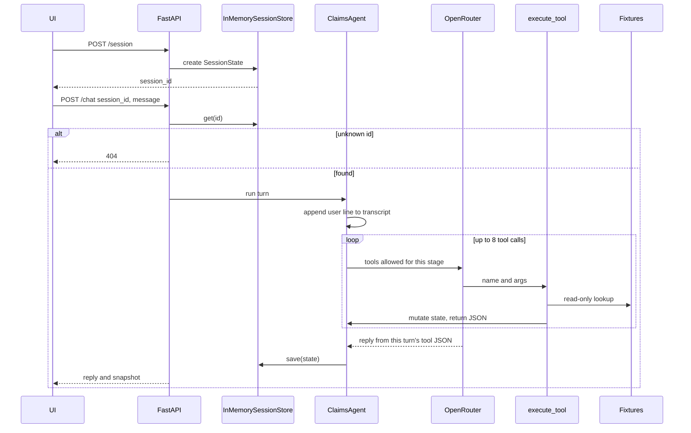
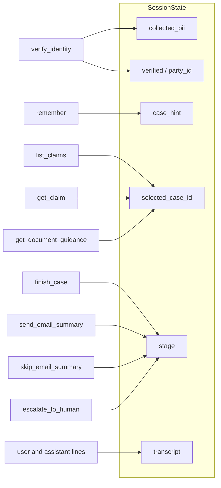

# GetClaim: AI Claim Agent

A conversational claims assistant that follows a support SOP without sounding like a script.

The language model writes replies and decides which tool to call. The harness owns identity, file access, and when the conversation is allowed to move forward. Claim facts are read from fixture tools only; the model does not invent a case file.

| | |
|---|---|
| Demo | [https://p01--getclaimed-harness-copy--yzdpgzzlcpd6.code.run](https://p01--getclaimed-harness-copy--yzdpgzzlcpd6.code.run) |
| Source | [Hyperion101010/getclaimed_harness](https://github.com/Hyperion101010/getclaimed_harness) |

The hosted demo uses [GLM 5.3 FlashX](https://openrouter.ai/z-ai/glm-5.3-flashx) through [OpenRouter](https://openrouter.ai/):

```
OPENROUTER_MODEL=z-ai/glm-5.3-flashx
OPENROUTER_BASE_URL=https://openrouter.ai/api/v1
```

Reload the page to start a new session. The hosted service runs as a **single replica**; session state is in process memory.

## Agent harness

A harness is the control plane around the model. GetClaim uses it so the assistant can be fluent in English and still cannot skip policy.

**What the model is allowed to do.** Parse messy utterances, ask clarifying questions, pick a tool, and phrase the answer.

**What the model is not allowed to do.** Mark a caller as verified, open a claim file, send an email summary, or change workflow stage. Those are tool side effects. If a tool is not in the current allow-list, the call is rejected.

That split is the product. Identity is a gate, not a suggestion. Until the verifier matches the caller to a policyholder on at least three independent fields (name, date of birth, phone, email, or ID last four), claim tools are not bound. Policy number is used only to look the person up. Name matching is fuzzy (rapidfuzz ≥ 88) so “Yaven Li” still reaches Ya Wen Li.

Callers often volunteer later-stage information too early (“I’m calling about the January healthcare denial”). The harness records that as a **hint** without leaving identity. After the gate opens, claim listing reuses the hint so the assistant does not start over. A unique match selects the file automatically; several matches are listed; none is reported as empty.

Once a file is selected, answers must come from `get_claim` and `get_document_guidance`. Wrap-up offers an email summary and sends it only after an explicit yes. A decline ends the session. A request for a person, or three failed identity matches, can escalate to a human.

## Architecture

Each browser tab is one session. `POST /session` allocates a `SessionState` in an in-memory store keyed by `session_id`. Every `POST /chat` loads that object, mutates it through tools, then writes it back. An unknown id returns 404; a second replica would not see the first replica’s store.



Tools write specific fields on the same `SessionState`. Fixtures are never modified.



The same process serves `GET /`, `GET /logo.png`, and `GET /healthz`. An empty unverified reply is replaced with an identity ask before save. GitHub renders the diagrams from [Mermaid](https://mermaid.js.org/).

## Setup

Python 3.12+ and an [OpenRouter](https://openrouter.ai/) API key.

```bash
python3 -m venv .venv
source .venv/bin/activate
pip install -r requirements.txt
cp .env.example .env
```

Set these in `.env`. Use the same model as the demo, or any other OpenRouter id:

```
OPENROUTER_API_KEY=your_key
OPENROUTER_MODEL=z-ai/glm-5.3-flashx
OPENROUTER_BASE_URL=https://openrouter.ai/api/v1
```

```bash
export PYTHONPATH=.
uvicorn apps.insurance_claims.api:app --reload --port 8000
```

Open http://127.0.0.1:8000

```bash
pytest apps/insurance_claims/tests -q
```

SOP and tool tests run offline. Tests that call the model need a key and network.

### Docker

```bash
docker build -t getclaimed .
docker run --rm -p 8000:8000 --env-file .env getclaimed
```

The image listens on `$PORT` (default 8000). Keep replicas at **one** or `/chat` will miss the session created on another process.

## Trying the demo

Reload, then send:

```text
I'm the policyholder. My name is Margaret Chen, policy POL-9921. I'm calling about my denied healthcare claim from January. DOB is 1985-03-15, SSN last four is 4472.
```

The assistant should finish identity before naming a claim, then land on **CL-2048** from the stored January / healthcare / denied hint. From there you can ask why it was denied and accept or skip the email.

Additional scripts live in [`apps/insurance_claims/sample_test_cases.md`](apps/insurance_claims/sample_test_cases.md).

| Caller | Policy | DOB | Last 4 | Notes |
|---|---|---|---|---|
| Margaret Chen | POL-9921 | 1985-03-15 | 4472 | Several claims; unique hint → CL-2048 |
| Ma Tian | POL-8836 | 1964-09-10 | 6688 | One denied healthcare claim |
| Ava Lopez | POL-1044 | 1990-08-21 | 9180 | No claims on file |
| Ya Wen Li / Yaven Li | POL-7742 | 1989-12-03 | 5317 | No claims on file |

## Project layout

```
.
├── Dockerfile
├── requirements.txt
├── .env.example
├── logo.png
└── apps/insurance_claims/
    ├── api.py                 HTTP + UI
    ├── agent.py               tool loop per turn
    ├── tools.py               SOP side effects and allow-lists
    ├── verifier.py            identity match against fixtures
    ├── state.py               session model
    ├── store.py               in-memory session store
    ├── llm.py                 OpenRouter client
    ├── context.py             reply/list helpers
    ├── guards.py              empty-reply fallback
    ├── escalation.py
    ├── fixtures_loader.py
    ├── fixture_models.py
    ├── config.py
    ├── static/index.html
    ├── fixtures/
    ├── tests/
    └── sample_test_cases.md
```

| Module | Responsibility |
|---|---|
| `api.py` | `/chat`, `/session`, static UI. One `ClaimsAgent` per process. |
| `agent.py` | Binds tools for the current stage and runs the loop. |
| `tools.py` | Identity, memory, claims, documents, email consent, escalation. |
| `verifier.py` | Field normalization and the three-field identity threshold. |
| `state.py` | Transcript, collected details, hint, selected case, workflow stage. |
| `static/index.html` | Chat UI, claim snapshot, sample-claim modal. |
| `fixtures/` | Policyholders, claims, and document guidelines. No live backend. |

Do not commit `.env`.
